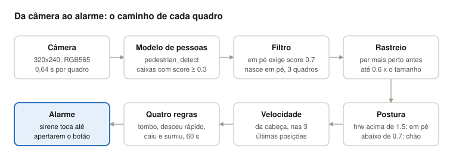
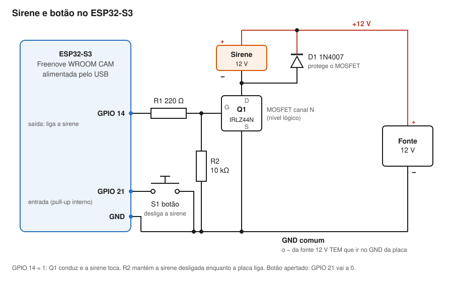

# Detector de quedas com ESP32-S3 — relatório

Este projeto é um detector de quedas que roda inteiro numa placa ESP32-S3 com câmera, sem nada preso ao corpo da pessoa. Quando detecta uma queda, toca uma sirene, que é desligada por um botão. Nos 70 vídeos da base pública URFD, a versão atual pegou 27 de 30 quedas, com 1 alarme falso em 40 vídeos de atividades normais.

**Sumário**

1. [Introdução](#1-introdução)
2. [O que usamos](#2-o-que-usamos)
3. [Algoritmo](#3-algoritmo)
4. [Explicação do algoritmo](#4-explicação-do-algoritmo)
5. [Sirene e botão: montagem do circuito](#5-sirene-e-botão-montagem-do-circuito)
6. [Testes e resultados](#6-testes-e-resultados)
7. [Conclusão e próximos passos](#7-conclusão-e-próximos-passos)
8. [Bibliografia](#8-bibliografia)

---

## 1) Introdução

Quedas são a segunda maior causa de morte por ferimento acidental no mundo, e os idosos são os mais atingidos (OMS, 2021). O perigo maior é ficar muito tempo no chão sem conseguir pedir ajuda. Pulseiras e celulares com acelerômetro resolvem parte disso, mas a pessoa precisa lembrar de usar e de carregar.

A proposta aqui é uma câmera barata no canto da sala que:

- acha as pessoas na imagem com uma rede neural pequena, rodando na própria placa;
- acompanha cada pessoa de um quadro para o outro;
- decide pela forma e pelo movimento da caixa se ela caiu;
- toca uma sirene quando alguém cai, até apertarem o botão ou a pessoa levantar.

Nenhuma imagem sai da placa para decidir a queda: tudo é processado localmente. A página web serve só para ver a câmera e para os testes.

## 2) O que usamos

Usamos uma placa ESP32-S3 com câmera e o framework oficial da Espressif (ESP-IDF v6.0.2). O modelo de detecção de pessoas também é da Espressif. No PC ficaram só as ferramentas de teste.

### Hardware

| Item | Detalhe |
| --- | --- |
| Placa | ESP32-S3 Freenove WROOM CAM, CPU de 2 núcleos a 240 MHz |
| Memória | Flash de 8 MB, PSRAM octal de 8 MB a 80 MHz (o modelo precisa dela) |
| Câmera | OV3660, imagem de 320x240 (QVGA) em RGB565 |
| Rede | Wi-Fi 2,4 GHz da própria placa |
| Sirene | Sirene piezo de 12 V, ligada por um MOSFET (seção 5) |
| Botão | Botão de pressão para desligar a sirene (seção 5) |

A flash foi dividida assim (`partitions.csv`): 4 MB para o programa e 2 MB para arquivos (SPIFFS), onde fica uma foto de teste.

### Bibliotecas na placa

| Biblioteca | Para que serve |
| --- | --- |
| `espressif/esp32-camera` 2.1 | Driver da câmera |
| `espressif/pedestrian_detect` 0.3.2 | Rede neural pronta que acha pessoas e devolve caixas com uma nota (score) |
| ESP-DL | Roda a rede neural e decodifica JPEG |
| `esp_wifi`, `esp_netif`, `esp_event`, `nvs_flash` | Conexão Wi-Fi |
| `esp_http_server` | Página web da câmera e endereços do modo teste |
| `esp_driver_gpio` | Pinos da sirene e do botão |
| `spiffs` | Arquivos na flash |
| `esp_timer`, FreeRTOS | Relógio em milissegundos e tarefas |

### Nosso código (`main/`)

| Arquivo | O que faz |
| --- | --- |
| `main.cpp` | Laço principal: pega a imagem, roda o modelo, chama a lógica de quedas, desenha as caixas, liga a sirene |
| `quedas.c` | A lógica de queda (seções 3 e 4). Não depende da placa e também compila no PC |
| `sirene.c` | Toque intermitente da sirene e leitura do botão, numa tarefa própria |
| `camera_ov2640.c` | Liga a câmera com os pinos da placa |
| `image_source.cpp` | Pega imagem da câmera, de arquivo ou de um JPEG na memória |
| `wifi.c` | Conecta e reconecta no Wi-Fi |
| `web.c` | Página `/` com a câmera ao vivo e a foto `/foto.jpg` |
| `teste.c` | Modo teste: recebe quadros de vídeo do PC |

### No PC (só para teste)

| Ferramenta | Para que serve |
| --- | --- |
| Python + OpenCV | Abrir os vídeos e salvar quadros em JPG |
| Python + Ultralytics YOLO11n | Detector de referência para comparar com a placa |
| `gcc` | Compilar o `quedas.c` no PC e simular a placa |
| `teste_videos/teste_videos.py` | Manda os quadros para a placa e calcula a estatística |

### Dados

A base pública URFD (University of Rzeszów Fall Detection Dataset) tem 30 vídeos de queda e 40 de atividades normais (andar, sentar, agachar, deitar na cama, pegar algo no chão). Cada vídeo tem 30 quadros por segundo, e a metade colorida da imagem tem 320x240, o mesmo tamanho da nossa câmera.

## 3) Algoritmo

A cada quadro, a placa roda o modelo de pessoas e passa as caixas para `quedas_update` (`quedas.c`). Essa função lembra de até 5 pessoas e decide, pessoa por pessoa, se houve queda. A placa leva cerca de 0,64 s por quadro.



As duas primeiras etapas ficam em `main.cpp`; do Filtro às Quatro regras, tudo está em `quedas.c`; a sirene e o botão, em `sirene.c`.

### Laço principal (`main.cpp`)

```text
liga a sirene (desligada), Wi-Fi, página web, câmera e modelo (score mínimo 0.3)
repete para sempre:
    se o PC mandou um comando de teste: atende e volta ao início
    imagem  = câmera (320x240)
    caixas  = modelo(imagem)            # até 5 caixas: x1, y1, x2, y2, score
    quedas_update(caixas, hora_ms)      # pode chamar alerta()
    se o navegador pediu foto: desenha as pessoas e manda o JPEG
    espera 200 ms

alerta(pessoa, motivo):
    se motivo é QUEDA:                     liga a sirene
    se motivo é "levantou" e ninguém mais
       está caído:                         desliga a sirene
```

### Decisão de queda (`quedas_update`)

```text
# 0) filtro
para cada caixa:
    descarta se está em pé (h/w > 1.5) e score < 0.7
    descarta se encosta em cima E embaixo da imagem

# 1) quem é quem
liga caixas a pessoas conhecidas, sempre o par mais perto primeiro
    só se o centro andou menos que 0.6 x tamanho da caixa
    deitada no quadro anterior não pode virar caixa em pé agora

# 2) atualiza cada pessoa vista
para cada caixa ligada (ou pessoa nova, que só nasce em pé):
    guarda posição no histórico (3 últimas: hora, topo, altura, centro x)
    vista 3 quadros seguidos -> confirmada
    r = altura / largura
    se já esteve em pé e cabeça desce > 0.7 alturas/s
         e já desceu > 40% da altura em pé:   marca DESCEU
    se r > 1.5:   EM PÉ  -> zera a queda; se tinha alarme -> "levantou"
    se r < 0.7:   NO CHÃO -> guarda a hora e a velocidade do tombo

# 3) decide e limpa
para cada pessoa confirmada:
    DESCEU, vista agora e 5 s depois ainda embaixo  -> QUEDA
    no chão, tombo > 1.0/s e 5 s no chão           -> QUEDA
    no chão há 60 s e já foi vista em pé           -> QUEDA
    sumiu com a cabeça descendo > 0.6 alturas/s
         e não voltou em 5 s                        -> QUEDA
    sumiu andando há 3 s (ou caída há 30 s / 5 min) -> esquece
pessoa não confirmada que falhou 1 quadro -> apaga (fantasma)
```

### Sirene e botão (`sirene.c`, tarefa própria a cada 10 ms)

```text
repete para sempre:
    se o botão está apertado há 50 ms e a sirene toca: desliga a sirene
    se a sirene toca: liga e desliga a saída a cada 0,5 s (bip intermitente)
    senão: saída desligada
```

## 4) Explicação do algoritmo

A ideia central é simples: uma pessoa em pé aparece como uma caixa alta e fina, e uma pessoa caída aparece como uma caixa larga e baixa. O resto do algoritmo existe para não se enganar: não confundir objetos com gente, não trocar uma pessoa pela outra e não dar alarme quando alguém só senta ou agacha.

### 4.1 O detector de pessoas

O modelo `pedestrian_detect` recebe a imagem de 320x240 e devolve uma caixa para cada pessoa, com uma nota de 0 a 1 (score). O padrão do modelo é aceitar caixas a partir de 0.7, mas uma pessoa deitada costuma pontuar só de 0.3 a 0.6. Por isso baixamos o limite para 0.3 e deixamos o `quedas.c` decidir quem vale.

### 4.2 Quem é pessoa (filtro)

Com o limite em 0.3 aparecem objetos que lembram gente: ventilador, porta, cadeira, sombra. Quatro regras seguram esses "fantasmas":

1. **Caixa em pé precisa de score 0.7.** Gente em pé pontua perto de 0.9; um ventilador alto e fino pontua menos.
2. **Caixa que encosta em cima e embaixo da imagem é ignorada.** É corpo cortado, porta ou algo colado na lente, e não dá para saber a postura.
3. **Pessoa nova só nasce em pé.** Algo deitado que surge do nada é quase sempre sofá, cama ou cadeira.
4. **Só vira pessoa depois de 3 quadros seguidos.** Se falhar um quadro antes disso, é apagada.

### 4.3 Quem é quem (rastreio)

A função `casa` liga cada caixa nova a uma pessoa que já estava sendo seguida. Ela sempre escolhe primeiro o par (caixa, pessoa) mais perto de todos, depois o próximo, e assim por diante. Decidir caixa por caixa podia trocar duas pessoas lado a lado.

A ligação só acontece se o centro da caixa andou menos de 0.6 vezes o tamanho dela. Com 1.0, a cadeira ao lado "roubava" a pessoa. Também não se liga uma pessoa deitada a uma caixa em pé no quadro seguinte, porque ninguém levanta do chão sem passar por sentado.

### 4.4 Postura pela forma da caixa

A postura vem da razão r = altura / largura da caixa no quadro atual:

| Razão h/w | Postura | O que o programa guarda |
| --- | --- | --- |
| acima de 1.5 | em pé | hora, forma, posição da cabeça e altura |
| entre 0.7 e 1.5 | sentada ou agachada | nada |
| abaixo de 0.7 | no chão | hora em que chegou ao chão e velocidade do tombo |

A velocidade do tombo é quanto a razão caiu por segundo desde a última vez em pé. Quem cai perde a forma em pé rápido; quem se deita devagar, não.

### 4.5 Histórico e velocidade da cabeça

Cada pessoa guarda as 3 últimas posições: hora, topo da caixa (a cabeça), altura e centro. Comparando a mais velha com a mais nova sai a velocidade da cabeça. Ela é medida em "alturas da pessoa por segundo", então não depende de a pessoa estar perto ou longe da câmera.

### 4.6 As quatro regras de queda

| Regra | Quando dispara | Que queda pega |
| --- | --- | --- |
| Tombo rápido | caixa passou de em pé para deitada a mais de 1.0 por segundo e ficou 5 s no chão | queda de lado |
| Desceu rápido e ficou embaixo | cabeça desceu a mais de 0.7 alturas/s, já está 40% abaixo de onde estava em pé e continua embaixo por 5 s | queda na direção da câmera, em que a caixa fica quadrada e nunca parece deitada |
| Caiu e sumiu | sumiu da imagem com a cabeça descendo a mais de 0.6 alturas/s e não voltou em 5 s | queda atrás de um móvel |
| Muito tempo no chão | 60 s no chão, para quem já foi vista em pé | queda lenta, como escorregar pela parede |

As esperas de 5 s separam a queda de quem só se abaixou para pegar algo. Quem sai andando da imagem tem a cabeça parada (velocidade perto de 0) e é esquecido depois de 3 s, sem alarme.

### 4.7 Levantou

Quando a caixa volta a ficar em pé, a queda é zerada. Se já tinha dado alarme, o programa avisa "levantou". Isso vale também para quem caiu e sumiu e reaparece em pé.

### 4.8 Memória de quem sumiu

| Situação | Tempo até esquecer |
| --- | --- |
| Sumiu andando | 3 s |
| Estava no chão, sem alarme | 30 s (o detector pisca com gente deitada) |
| Já deu alarme | 5 min (alguém pode estar na frente dela) |

### 4.9 Sirene e botão

| Evento | O que a sirene faz |
| --- | --- |
| Qualquer uma das quatro regras dá QUEDA | começa a tocar, intermitente (0,5 s ligada, 0,5 s desligada) |
| Alguém aperta o botão | para na hora |
| A pessoa levanta e ninguém mais está caído | para sozinha |
| Outra pessoa cai depois | toca de novo |

Cada queda gera um alarme só uma vez. Depois que o botão desliga a sirene, a mesma queda não a liga de novo; só uma queda nova liga. No modo teste (vídeos vindos do PC) a sirene não toca.

O botão é lido por uma tarefa separada do FreeRTOS, a cada 10 ms. Assim ele responde na hora, mesmo com o laço principal ocupado os 0,64 s do modelo. Uma leitura só conta depois de 50 ms apertado, porque o contato mecânico "pula" ao ser apertado.

## 5) Sirene e botão: montagem do circuito

O pino GPIO 14 liga um MOSFET que alimenta a sirene de 12 V; o botão fica entre o GPIO 21 e o GND. A sirene tem fonte própria, porque a placa não fornece 12 V nem a corrente que ela pede.



### Lista de material

| Peça | Valor / modelo | Função |
| --- | --- | --- |
| Q1 | MOSFET canal N de nível lógico, IRLZ44N | Chave que liga a sirene |
| R1 | 220 Ω | Limita a corrente no gate |
| R2 | 10 kΩ | Mantém a sirene desligada enquanto a placa liga |
| D1 | Diodo 1N4007 | Protege o MOSFET do pico de tensão da sirene |
| Sirene | Sirene piezo 12 V | Alarme sonoro |
| S1 | Botão de pressão (normalmente aberto) | Desliga a sirene |
| Fonte | 12 V, 1 A | Alimenta a sirene |

### Ligações

| De | Para |
| --- | --- |
| GPIO 14 | R1 → gate (G) do Q1 |
| Gate do Q1 | R2 → GND |
| Source (S) do Q1 | GND |
| Drain (D) do Q1 | fio − da sirene |
| Fio + da sirene | +12 V da fonte |
| D1 | em paralelo com a sirene: listra (catodo) no +12 V, outro lado no drain |
| GPIO 21 | um lado do botão S1 |
| Outro lado do botão S1 | GND |
| − da fonte 12 V | GND da placa (GND comum) |

### Cuidados

- **O GND tem que ser comum.** Sem ligar o − da fonte 12 V no GND da placa, o MOSFET não liga.
- **Nunca ligue 12 V em nenhum pino da placa.** Os pinos do ESP32-S3 aguentam só 3,3 V.
- **O botão não precisa de resistor.** O código liga o pull-up interno do GPIO 21: solto lê 1, apertado lê 0.
- **Os pinos 14 e 21 estão livres nesta placa.** A câmera usa 4 a 13 e 15 a 18, e o cartão SD usa 38 a 40. Em outra placa, confira o esquemático e mude `PINO_SIRENE` e `PINO_BOTAO` em `main/sirene.c`.
- **Buzzer de 5 V também serve.** O circuito é o mesmo; troque a fonte de 12 V pelo 5 V da placa.

O circuito e o código da sirene ainda não foram testados na placa.

## 6) Testes e resultados

A versão atual detectou 27 de 30 quedas (90%) com 1 alarme falso em 40 vídeos normais (2,5%), contando que a pessoa fica no último quadro por 6 s.

### Como os vídeos viraram teste

1. Cada vídeo URFD foi aberto com OpenCV e ficamos com 1 quadro a cada 10 (3 por segundo, perto da velocidade da placa).
2. Cortamos a metade direita (a câmera colorida de 320x240) e salvamos em JPG. Deu 70 pastas e 1210 imagens.
3. O `teste_videos.py` manda os quadros à placa pela rede (`/teste/inicio`, `/teste/quadro`, `/teste/fim`). A placa roda o mesmo modelo e o mesmo `quedas.c` da câmera, com a hora de cada quadro simulada.
4. No fim do vídeo a placa repete o último quadro, para as regras que esperam 5 s ou 60 s.
5. As caixas que a placa achou ficam em `caixas_placa.csv`. Com elas, o `quedas.c` compilado no PC dá exatamente o mesmo resultado da placa, então os ajustes de parâmetro foram testados no PC.

Também há testes sintéticos no PC, com caixas inventadas para cada situação: cair, sentar devagar, ventilador, porta, sair andando, cair e sumir, cair na direção da câmera.

### Evolução (último quadro repetido por 70 s)

| Versão | Quedas pegas (de 30) | Alarmes falsos (de 40) |
| --- | --- | --- |
| PC, YOLO, regras originais (score 0.6, velocidade 1.5) | 12 | 2 |
| PC, YOLO, score 0.3 + score por postura | 19 | — |
| PC, YOLO, velocidade 1.0 | 20 | 4 |
| Placa, RAZAO_CAIDO 0.8 | 26 | 13 |
| Placa, RAZAO_CAIDO 0.7 | 26 | 5 |
| Simulação da placa, 0.7 + "desceu rápido" + DIST_MAX 0.6 | 30 | 5 |

### Resultado mais realista (último quadro repetido por 6 s)

Repetir 70 s exagera os falsos: os vídeos adl-31, 32, 34 e 38 terminam com a pessoa agachada, e repetir esse quadro equivale a ela ficar 70 s no chão. Na vida real ela levanta.

| Versão | Quedas pegas (de 30) | Alarmes falsos (de 40) |
| --- | --- | --- |
| RAZAO_CAIDO 0.8 | 25 | 6 |
| RAZAO_CAIDO 0.7 | 23 | 1 |
| RAZAO_CAIDO 0.65 | 21 | 0 |
| **Atual** (0.7 + "desceu rápido" + DIST_MAX 0.6) | **27** | **1** |

- O único falso que sobrou é o adl-37: a pessoa se joga na cama.
- Quedas perdidas: fall-08, fall-10 e fall-16.
- Velocidade na placa: 0,64 s por quadro.

### Ideias testadas e descartadas

| Ideia | Por que saiu |
| --- | --- |
| Altura menor que metade da altura em pé = caída | Mais alarmes falsos (sentar no sofá) |
| Objeto que nunca anda não é pessoa | Quedas pegas caíram de 20 para 7 |
| Prever a posição futura no rastreio | O ganho era sorte: a pessoa era trocada pela cadeira |
| Desconfiar de caixa deitada com score baixo que não vinha descendo | Só perdeu quedas (23 para 20) |
| VEL_SUMIU 0.35 | Nenhuma queda a mais e 3 falsos a mais |

## 7) Conclusão e próximos passos

Uma placa de baixo custo com câmera consegue detectar quedas sozinha: 27 de 30 quedas e 1 alarme falso em 40 vídeos da base URFD. O ganho veio menos do modelo e mais das regras em volta dele: filtrar fantasmas, seguir cada pessoa e olhar o movimento da cabeça, além da forma da caixa. A sirene com botão fecha o ciclo: quem está perto ouve o alarme e o desliga ao chegar.

As limitações são claras. A base URFD tem vídeos curtos de uma sala só, então a regra dos 60 s no chão não pôde ser avaliada. Cama e sofá ainda confundem (adl-37), e três quedas continuam passando.

Próximos passos:

- [ ] Montar e testar a sirene e o botão na placa.
- [ ] Testar na sala real, com a câmera a 1,5–2 m de altura, inclinada para baixo e mostrando o chão.
- [ ] Marcar áreas a ignorar (cama, sofá).
- [ ] Mandar o alarme também para fora da placa (MQTT ou Telegram), na função `alerta()`.
- [ ] Estudar as quedas perdidas: fall-08, fall-10 e fall-16.
- [ ] Gravar vídeos longos para avaliar a regra dos 60 s.

## 8) Bibliografia

1. KWOLEK, B.; KEPSKI, M. Human fall detection on embedded platform using depth maps and wireless accelerometer. *Computer Methods and Programs in Biomedicine*, v. 117, n. 3, p. 489–501, 2014. Base de dados: [UR Fall Detection Dataset](http://fenix.ur.edu.pl/~mkepski/ds/uf.html).
2. MUBASHIR, M.; SHAO, L.; SEED, L. A survey on fall detection: principles and approaches. *Neurocomputing*, v. 100, p. 144–152, 2013.
3. ORGANIZAÇÃO MUNDIAL DA SAÚDE. [Falls](https://www.who.int/news-room/fact-sheets/detail/falls). Nota descritiva, 2021.
4. ESPRESSIF SYSTEMS. [ESP32-S3 Series Datasheet](https://www.espressif.com/sites/default/files/documentation/esp32-s3_datasheet_en.pdf).
5. ESPRESSIF SYSTEMS. [ESP-IDF Programming Guide](https://docs.espressif.com/projects/esp-idf/en/latest/esp32s3/).
6. ESPRESSIF SYSTEMS. [ESP-DL](https://github.com/espressif/esp-dl) e o componente [pedestrian_detect](https://components.espressif.com/components/espressif/pedestrian_detect).
7. ESPRESSIF SYSTEMS. [esp32-camera](https://github.com/espressif/esp32-camera): driver de câmera para ESP32.
8. FREENOVE. [Freenove ESP32-S3 WROOM Board](https://github.com/Freenove/Freenove_ESP32_S3_WROOM_Board): documentação e esquemático.
9. INFINEON. IRLZ44N: HEXFET Power MOSFET. Folha de dados.
10. JOCHER, G.; QIU, J. [Ultralytics YOLO11](https://github.com/ultralytics/ultralytics), 2024.
11. BRADSKI, G. The OpenCV Library. *Dr. Dobb's Journal of Software Tools*, 2000.
